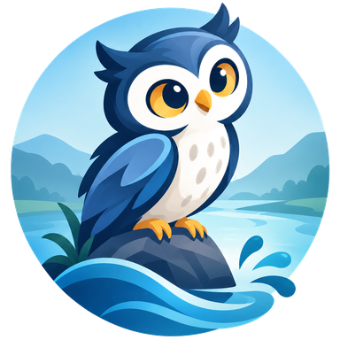
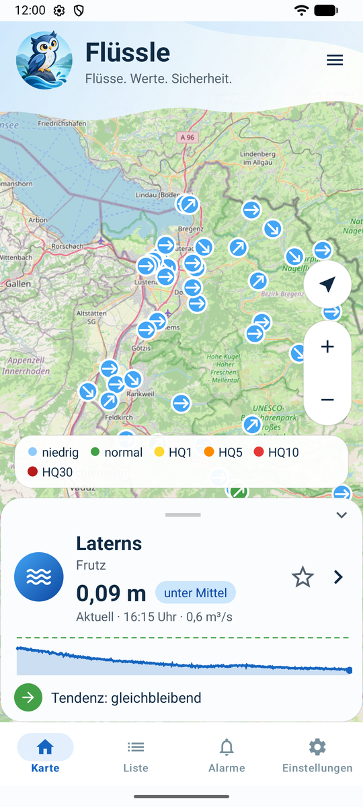
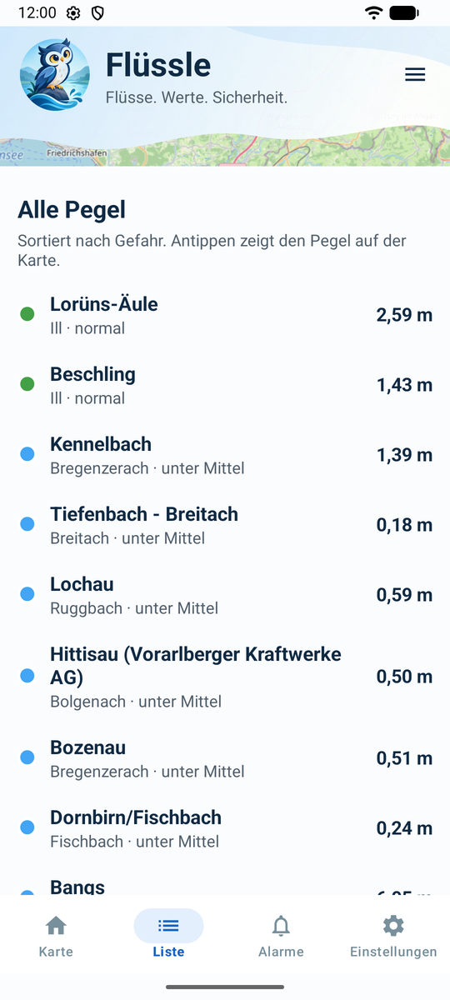
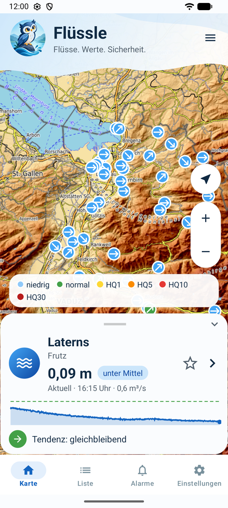
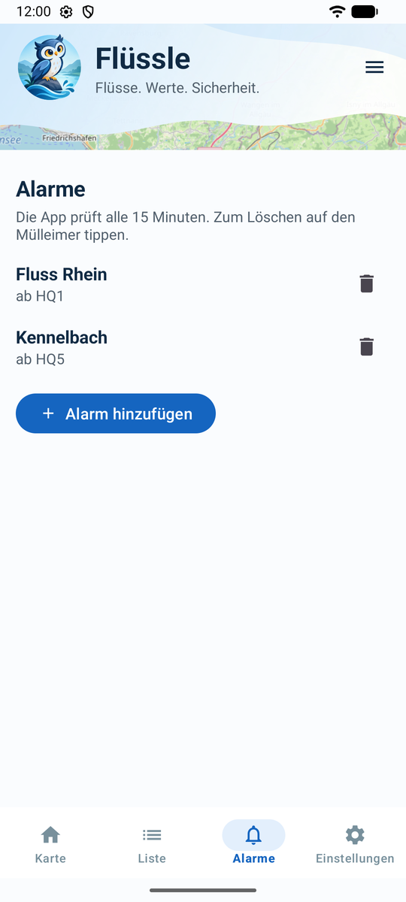
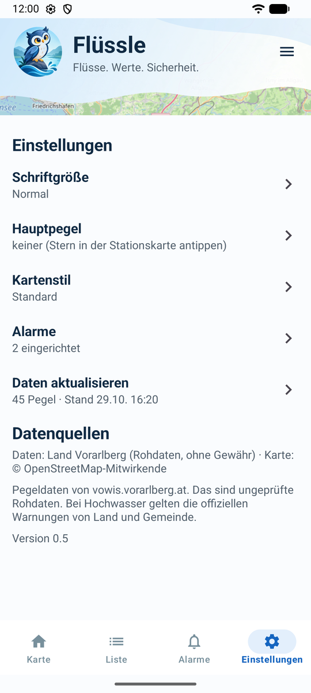

  

<h1 align="center">Flüssle</h1>

  <em>Flüsse. Werte. Sicherheit.</em> 
  Die Flusspegel von Vorarlberg auf einen Blick, mit Hochwasser-Alarm aufs Handy.

  
  
  
  

  
  &nbsp;
  
  &nbsp;
  

## Was kann Flüssle?

| | |
|---|---|
| 🗺️ **Karte** | Alle 45 Pegel des Landes auf einer OpenStreetMap-Karte, eingefärbt nach Abflussklasse von „niedrig“ bis HQ300. Der Pfeil im Punkt zeigt, ob der Fluss steigt oder fällt. Wahlweise im Kartenstil Standard oder Gelände. |
| 📈 **Stationskarte** | Antippen zeigt Wasserstand, Abfluss, Klasse, Tendenz und den Verlauf der letzten 3 Tage. Ein weiterer Tipp öffnet das große Diagramm. |
| ⭐ **Hauptpegel** | Mit dem Stern wird dein Fluss zum Hauptpegel und öffnet sich beim Start. |
| 🔔 **Alarme** | Benachrichtigung, sobald ein Pegel oder ein ganzer Fluss eine Hochwasserstufe erreicht. Geprüft wird alle 15 Minuten im Hintergrund. |
| 🔠 **Gut lesbar** | Die Schriftgröße lässt sich in der App bis „Riesig“ einstellen. |
| 🔒 **Ohne Server** | Die App liest die öffentlichen Daten des Landes direkt. Kein Konto, keine Werbung, kein Tracking. |

  
  &nbsp;
  

## Installieren

1. Die neueste APK unter **[Releases](https://github.com/die-Anna/Fl-ssle/releases/latest)** herunterladen.
2. Am Handy öffnen und die Installation aus dieser Quelle erlauben.
3. Fertig. Beim ersten Alarm fragt die App, ob sie Benachrichtigungen schicken darf.

> [!WARNING]
> Flüssle ist ein privates Projekt und **keine offizielle App** des Landes Vorarlberg. Die Werte sind ungeprüfte Rohdaten.
> Bei Hochwasser gelten immer die offiziellen Warnungen von Land, Gemeinde und Einsatzkräften.

## Woher kommen die Daten?

Alle Pegeldaten stammen von **[vowis.vorarlberg.at](https://vowis.vorarlberg.at/stationswrapper)**, dem Wasserinformationssystem des Landes Vorarlberg:

- **Aktuelle Werte, Lage, HQ-Kennwerte, Klasse und Tendenz:** GeoServer-Dienst (`/geoserver/owf/ows`, Layer `owf:Pegel`, GeoJSON).
- **Fluss und Flussgebiet:** Stationstabelle `tbl_Abflussstationen.aspx`.
- **Abfluss-Verlauf:** CSV-Download `charts/dlt_DownloadAbfluss.php` (5-Minuten-Werte, für 30 Tage und 1 Jahr ausgedünnt).
- Für Lorüns-Äule, Lorüns (Restwasser) und Beschling stellt vowis keinen Verlauf bereit.

Kartenkacheln: © OpenStreetMap-Mitwirkende bzw. OpenTopoMap (CC-BY-SA).

<strong>Für Entwickler: Aufbau und Bauen</strong>

### Aufbau

- `core/`: reine Kotlin-Datenlogik ohne Android (Abruf, JSON/CSV/HTML-Auswertung, Abflussklassen, Alarm-Regeln), mit Unit-Tests.
- `app/`: Android-Oberfläche mit osmdroid-Karte, Liste, Alarmen (WorkManager) und Einstellungen.

### Bauen

1. Ordner in **Android Studio** öffnen und den Gradle-Sync abwarten.
2. Emulator anlegen oder Handy per USB verbinden, dann ▶ Run.
3. Auf der Kommandozeile mit JDK 21 (nicht dem Java 25 aus Android Studio): `gradlew assembleDebug`.
   Nur die Datenlogik testen, ohne Android SDK: `gradlew -PcoreOnly :core:test`.

Jeder Push auf `main` baut die APK automatisch (Actions → Artefakt). Ein Release entsteht über
Actions → „APK bauen“ → *Run workflow* mit einer Versionsnummer wie `v0.6`.

### Nächste Schritte

- Weitere Regionen über den Bundes-Datensatz „Aktuelle Pegelstände Österreich“ (eHYD, CC BY 4.0).

## Lizenz

Code unter der [MIT-Lizenz](LICENSE). Das Logo wurde mit ChatGPT erstellt.
Pegeldaten: Land Vorarlberg (vowis).
